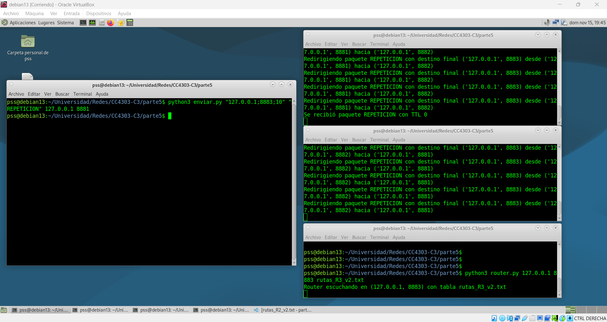
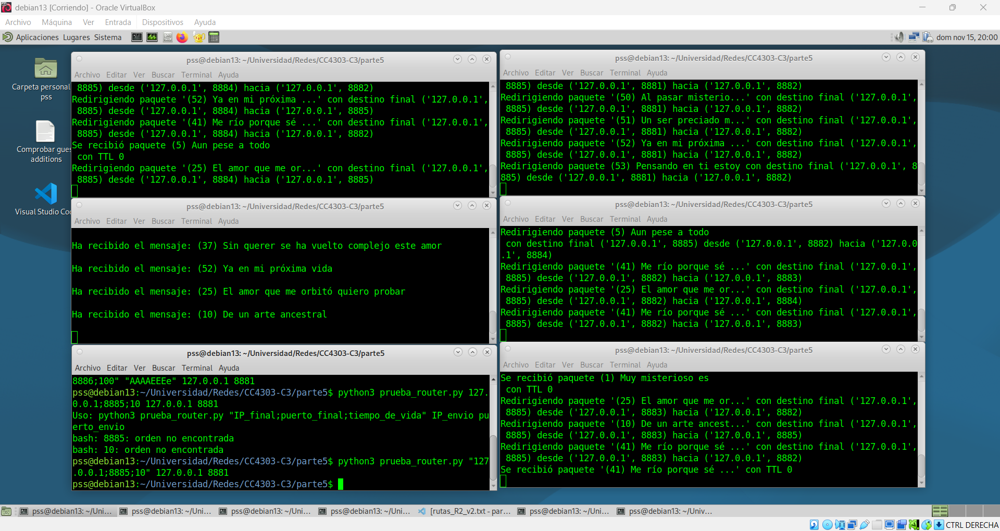

# CC4303-C3

# Informe parte 5: Forwarding básico

Integrantes: César Barrueto, Jaime Sepúlveda
Fecha: 16/11/2026
Profesora: Ivana Bachmann.
Auxiliar: Julián Ferreira

Enlace de github: [https://github.com/memobob1/CC4303-C3/tree/main/parte5](https://github.com/memobob1/CC4303-C3/tree/main/parte5)

Disclaimer Uso de IA: Se utilizó Claude para documentar la mayor parte del archivo "router.py".

## Comparación entre la tabla de rutas de esta actividad y la real

- La tabla de rutas real agrupa rangos de direcciones IP utilizando una IP específica y una máscara. Por otro lado, nuestra tabla de rutas utiliza una única IP
  y un rango de puertos para agrupar las direcciones IP de los distintos routers. La tabla de rutas de la actividad también incluye la máscara, pero
  no es importante, ya que la IP siempre es la misma.
- Para avanzar por la red, la tabla de rutas real devuelve la IP del siguiente router y la interfaz de salida desde donde será enviado el paquete.
  Por el contrario, en nuestra tabla de rutas se devuelve la IP y el puerto del siguiente router (socket UDP).

## Round Robin y la clase RoutesToArea

Para implementar Round Robin es necesario que el router pueda alternar entre las rutas que se dirigen a una misma área de la red. Eso implica
que el router debe poder recordar cuál fue la última ruta que utilizó para mandar mensajes a una red determinada.

Nosotros creamos la clase RoutesToArea que agrupa todas las rutas posibles, desde un router en específico, para dirigirse a la misma red.
Esta clase es la que se encarga de alternar entre routers (con Round Robin) y devolver la siguiente ruta a usar.
También tiene la capacidad de identificar si la dirección final de un paquete pertenece a su red.

### Atríbutos de la clase RoutesToArea:

- ip: Un string con la IP de la red de destino.
- bits_to_compare: Un entero con el largo del prefijo CIDR (cuántos bits de la IP definen la red).
- first_port: Un entero con el primer puerto del rango de destino.
- last_port: Un entero con el último puerto del rango de destino.
- possible_routes: La lista de rutas (IP, puerto) que existen para viajar la red de destino.
- next_hop_idx: Un entero con el índice de la próxima ruta a usar para viajar a la red (round-robin).

### Métodos de la clase RoutesToArea:

- add_route: Recibe una ruta (IP, puerto) y la añade a la lista de "possible_routes". Se utiliza cuando se instancia esta clase para añadir
  todas las rutas de la tabla de rutas.
  
- contains_address: Recibe una dirección final (IP, puerto) y revisa si esa dirección pertenece a la red asociada a esta clase, utilizando:
  
  ```
  ip[:self.bits_to_compare] == self.ip[:self.bits_to_compare] and self.first_port <= port <= self.last_port
  ```
  La primera igualdad siempre se cumple pues en esta actividad utilizamos la misma IP para todos los routers.
  
- get_next_hop: Devuelve la i-ésima ruta almacenada en "possible_routes", donde el valor de i es "next_hop_idx". Luego, actualiza "next_hop_id" para
  que apunte hacia la siguiente ruta de la lista:
  
  ```
  self.next_hop_idx = (self.next_hop_idx + 1) % len(self.possible_routes)
  ```
  Esa línea de código permite implementar Round Robin y alternar entre las distintas rutas.

## El router default

En esta actividad nuestro router default se encuentra en la dirección (127.0.0.1, 7000). Queremos que los routers solamente envíen mensajes a esta dirección
cuando ninguna de las otras rutas de la tabla de rutas permitan llegar a la dirección final. Por lo tanto, la ruta default se debe revisar al final,
es decir, la ruta default debe ubicarse en la última línea de todas las tablas de rutas.

Por ejemplo, la tabla de rutas de R2 luce de la siguiente forma:
```
# archivo rutas_R2_v3.txt
127.0.0.1/24 8881 8881 127.0.0.1 8881
127.0.0.1/24 8883 8885 127.0.0.1 8883
127.0.0.1/24 8883 8885 127.0.0.1 8884
127.0.0.1/0 0 65535 127.0.0.1 7000
```
Notar que la ruta default acepta todas las IPs (la máscara es 0), y todos los puertos posibles (desde el puerto 0 hasta el puerto 65535).

## Script para enviar un mensaje

Cuando los routers ya están encendidos en otras consolas, nuestro script "enviar.py" permite enviar un mensaje desde un router
determinado hacia otro router. El comando para usarlo (en una terminal aparte) es de la siguiente forma:
```
python3 enviar.py "IP_final;puerto_final;tiempo_de_vida" "mensaje" IP_envio puerto_envio
```
Por ejemplo, para enviar el mensaje "The Apothecary Diaries" desde R1 hacia R4, con un TTL de 15, se ejecuta:
```
python3 enviar.py "127.0.0.1;8884;15" "The Apothecary Diaries" 127.0.0.1 8881
```

## Script para enviar un gran archivo de texto

Cuando los routers ya están encendidos en otras consolas, nuestro script "prueba_router.py" permite enviar cada línea de un archivo de texto,
desde un router determinado hacia otro router. El archivo se llama "texto_de_prueba.txt" y contiene la letra de un cover en español de
la canción "Kusushiki".

El comando para usarlo (en una terminal aparte) es de la siguiente forma:
```
python3 prueba_router.py "IP_final;puerto_final;tiempo_de_vida" IP_envio puerto_envio'
```
Por ejemplo, para enviar la canción desde R1 hacia R5, con un TTL de 10, se ejecuta:
```
python3 prueba_router.py "127.0.0.1;8885;10" 127.0.0.1 8881
```

## Pruebas Mini-Internet sin TTL

1) El fallo provoca que R2 retransmita un mensaje hacia R1 cuando en realidad quiere enviarlo a R3. Por lo tanto, al intentar enviar un
   paquete desde R1 hacia R3, se genera un bucle infinito donde R1 envía un mensaje a R2, R2 lo devuelve a R1, y R1 lo vuelve a enviar a R2.

2) Usando la configuración de 5 routers, el primer mensaje desde R1 hacia R5 realiza 7 saltos de la siguiente forma:
   ```
   R1 -> R2 -> R3 -> R2 -> R4 -> R2 -> R3 -> R5
   ```
   Luego, el segundo mensaje desde R1 hacia R5 realiza 3 saltos de la siguiente manera:
   ```
   R1 -> R2 -> R4 -> R5
   ```
   El tercer mensaje imita el mismo orden que el primer mensaje (7 saltos). Mientras que el cuarto mensaje imita el orden del segundo mensaje (3 saltos).
   Y así sucesivamente. Por lo tanto, la cantidad de saltos que dan los paquetes desde R1 a R5 son: 7, 3, 7, 3, 7, 3, 7, 3, ...

   Podemos notar una gran diferencia entre la cantidad de saltos de cada envío, pues 7 es mayor al doble de 3. El principal retraso es causado cuando
   los paquetes recibidos por R3 y R4 son reenviados a R2 en lugar de ser retransmitidos a R5.

3) Usando la configuración de 7 routers, el primer mensaje desde R1 hacia R5 realiza 11 saltos de la siguiente forma:
   ```
   R1 -> R0 -> R1 -> R2 -> R3 -> R2 -> R4 -> R2 -> R6 -> R2 -> R3 -> R5
   ```
   Luego, el segundo mensaje desde R1 hacia R5 realiza 4 saltos de la siguiente manera:
   ```
   R1 -> R0 -> R2 -> R4 -> R5
   ```
   El tercer mensaje realiza 12 saltos de la siguiente forma:
   ```
   R1 -> R2 -> R6 -> R3 -> R6 -> R2 -> R3 -> R2 -> R4 -> R2 -> R6 -> R3 -> R5
   ```
   El cuarto mensaje ocupa 8 saltos, el quinto mensaje usa 7, el sexto mensaje utiliza 11, y el séptimo mensaje realiza 7. A primera vista, no pareciera
   existir un patrón. Una observación importante es que el promedio de saltos para enviar cada mensaje aumenta bastante cuando hay más rutas, pues
   el mensaje puede dar más vueltas entre los routers. Además, ninguno de los 7 mensajes ocupó la ruta más corta de tres saltos que
   sería (R1 -> R2 -> R3/R4 -> R5).

   Los archivos de rutas que se crearon para este item son:

   ```
   # archivo rutas_R0_v3_t2.txt
   127.0.0.1/24 8881 8886 127.0.0.1 8881
   127.0.0.1/24 8881 8886 127.0.0.1 8882
   127.0.0.1/0 0 65535 127.0.0.1 7000
   ```
   ```
   # archivo rutas_R1_v3_t2.txt
   127.0.0.1/24 8880 8880 127.0.0.1 8880
   127.0.0.1/24 8880 8880 127.0.0.1 8882
   127.0.0.1/24 8882 8886 127.0.0.1 8880
   127.0.0.1/24 8882 8886 127.0.0.1 8882
   127.0.0.1/0 0 65535 127.0.0.1 7000
   ```
   ```
   # archivo rutas_R2_v3_t2.txt
   127.0.0.1/24 8880 8881 127.0.0.1 8880
   127.0.0.1/24 8880 8881 127.0.0.1 8881
   127.0.0.1/24 8883 8886 127.0.0.1 8883
   127.0.0.1/24 8883 8886 127.0.0.1 8884
   127.0.0.1/24 8883 8886 127.0.0.1 8886
   127.0.0.1/0 0 65535 127.0.0.1 7000
   ```
   ```
   # archivo rutas_R3_v3_t2.txt
   127.0.0.1/24 8880 8882 127.0.0.1 8882
   127.0.0.1/24 8880 8882 127.0.0.1 8885
   127.0.0.1/24 8880 8882 127.0.0.1 8886
   127.0.0.1/24 8884 8886 127.0.0.1 8882
   127.0.0.1/24 8884 8886 127.0.0.1 8885
   127.0.0.1/24 8884 8886 127.0.0.1 8886
   127.0.0.1/0 0 65535 127.0.0.1 7000
   ```
   ```
   # archivo rutas_R4_v3_t2.txt
   127.0.0.1/24 8880 8883 127.0.0.1 8882
   127.0.0.1/24 8880 8883 127.0.0.1 8885
   127.0.0.1/24 8885 8886 127.0.0.1 8882
   127.0.0.1/24 8885 8886 127.0.0.1 8885
   127.0.0.1/0 0 65535 127.0.0.1 7000
   ```
   ```
   # archivo rutas_R5_v3_t2.txt
   127.0.0.1/24 8880 8884 127.0.0.1 8883
   127.0.0.1/24 8880 8884 127.0.0.1 8884
   127.0.0.1/24 8886 8886 127.0.0.1 8883
   127.0.0.1/24 8886 8886 127.0.0.1 8884
   127.0.0.1/0 0 65535 127.0.0.1 7000
   ```
   ```
   # archivo rutas_R6_v3_t2.txt
   127.0.0.1/24 8880 8885 127.0.0.1 8882
   127.0.0.1/24 8880 8885 127.0.0.1 8883
   127.0.0.1/0 0 65535 127.0.0.1 7000
   ```
## Pruebas Mini-Internet con TTL

1) La principal diferencia es que el mensaje deja de estar en un bucle infinito entre R1 y R2. Ahora el mensaje eventualmente llega a R1 con un TTL igual a 0,
   y es desechado por R1, finalizando su viaje. Esto se puede ver en la siguiente imagen.

   

3) El orden se pierde completamente. Una buena parte de los mensajes se pierden durante el viaje cuando su TTL llega a 0, y el resto de mensajes que logra llegar    a R5, ingresan en completo desorden.

   Lo anterior se puede ver en la siguiente imagen, donde R5 es la terminal de la izquierda que se ubica en el centro de la pantalla.
   Los números en paréntesis indican el número de línea de cada mensaje dentro del archivo "texto_de_prueba.txt".

   
